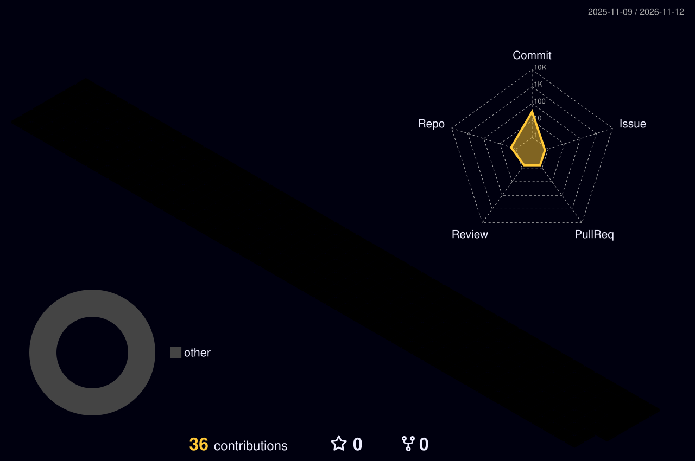

<!-- ================================= -->
<!-- FUTURISTIC 3D PROFILE HEADER -->
<!-- ================================= -->

  

  

  
  

  

<!-- ABOUT ME - ANIMATED SECTION -->

<h2 align="center">👨‍💻 About Me</h2>

  

  🇮🇳 Based in India
   
  🎮 Aspiring Game Developer
   
  🤖 Interested in Artificial Intelligence
   
  ⚡ Building <b>ZypeCode</b>
   
  🚀 Love creating innovative projects

  
  

## ⚡ Programming Languages

  

---

## 🛠️ Tools & Platforms

  

---

<!-- ================================= -->
<!-- FEATURED PROJECTS -->
<!-- ================================= -->

<h2 align="center">🚀 Featured Projects</h2>

  <i>Things I'm building, creating and experimenting with.</i>

<table width="100%">
<tr>
<td width="50%" valign="top">

<h3 align="center">⚡ ZypeCode</h3>

  
  

  An AI-powered coding assistant designed to make terminal-based development smarter and easier.

  <b>🚧 Status: Building</b>

  <b>⚡ Focus:</b> AI & Terminal Development

</td>

<td width="50%" valign="top">

<h3 align="center">🤖 AI SaaS</h3>

  
  

  Developing modern AI-powered software products with a focus on innovation and user experience.

  <b>🔄 Status: In Progress</b>

  <b>⚡ Focus:</b> AI & Software Development

</td>
</tr>
</table>

  

## 📊 GitHub Statistics

  

  

  

---

## 🧊 3D Contribution Graph

  

  <i>Every contribution builds something bigger 🚀</i>

---

<!-- ================================= -->
<!-- 3D ANIMATED THANK YOU FOOTER -->
<!-- ================================= -->

  

  

  
  

  <b>© Udit Patidar | @UditXP</b>

  <i>Code. Create. Innovate. Repeat.</i>

  

